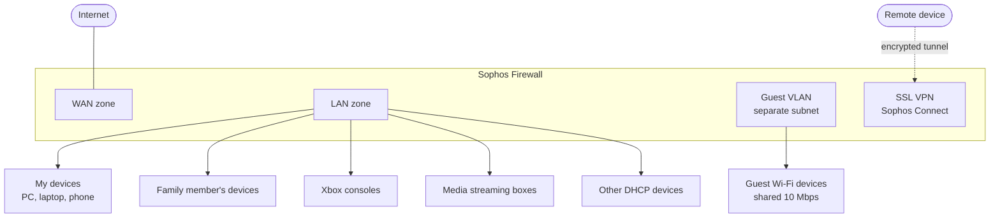

# Sophos Firewall Home Network

I built and secured my home network from scratch with **Sophos Firewall (free Home Edition)**, running on a dedicated desktop PC. The goal was the same as a small business network: **segment devices, apply least privilege per device type, control web and application use, share bandwidth fairly, and allow secure remote access**.

## Overview

| Item | Value |
|---|---|
| Firewall | Sophos Firewall Home Edition (the release before the current major version) |
| Hardware | Desktop PC with two network interfaces |
| Zones | LAN, WAN, Guest (separate VLAN) |
| Remote access | SSL VPN with Sophos Connect, local user accounts |
| Protection | Web policies, application control, bandwidth shaping |
| Operations | Hardened admin access, logging and reports, weekly configuration backups |

## Architecture

## Firewall rule design

Each group of devices has its **own rule**, with access matched to what those devices actually need. Rules are processed **top to bottom**, so specific rules sit above general ones.

| # | Rule | Source | Allowed | Web and app control | Bandwidth |
|---|---|---|---|---|---|
| 1 | VPN inbound | SSL VPN users | Access to LAN resources | Applied | Default |
| 2 | Unrestricted | My PC, laptop and phone | All services | Web policy and app control still enforced | **High guaranteed bandwidth** |
| 3 | Restricted | A family member's devices | Only specific approved services | Strict web policy and app control | Default |
| 4 | Xbox | Xbox consoles | Only the services the consoles need for gaming and updates | Applied | Default |
| 5 | Media streaming | Streaming boxes | Only the streaming services they need | Applied | Default |
| 6 | DHCP general | All other devices on the LAN | Common services (semi-restricted) | Applied | Default |
| 7 | Guest Wi-Fi | Guest VLAN | Internet only, no access to the LAN | Strict | **10 Mbps shared limit** |
| — | Default drop | Anything else | Nothing | — | — |

**Why this design:**
- **Least privilege per device type.** A games console or streaming box only needs a handful of services, so that's all it gets. If one is compromised, it can't do much.
- **Even trusted devices are filtered.** My own devices have no service restrictions, but web and application policies still apply, so malicious sites and high-risk apps are blocked everywhere.
- **Guests are isolated.** The guest VLAN is a separate subnet with no route to the LAN, and a shared bandwidth limit stops one guest slowing down the whole connection.
- **Bandwidth is prioritised.** My devices have a guaranteed share, so work and study traffic stays fast.

## Application control

- **Blocked high-risk applications for everyone**, using Sophos's risk ratings.
- **Blocked P2P and torrent clients, proxy and VPN-bypass tools, and file-sharing apps**, which are common ways to get around filtering or bring in malware.
- **Added exceptions** for legitimate apps caught by the broad categories, such as **WhatsApp**.

## Web policies

- Applied web filtering on every rule, with **stricter category blocking on the restricted and guest rules**.
- Blocked malicious and high-risk website categories for all devices.

## Remote access VPN

- Configured **SSL VPN remote access**, connecting with the **Sophos Connect** client.
- Authenticated with **local user accounts** on the firewall.
- Added an inbound firewall rule for VPN users, so remote access only reaches what it needs to.

## Hardening and operations

- **Restricted admin access**, so the web console and SSH aren't reachable from the WAN.
- **Enabled MFA** for administrator sign-in.
- **Changed default admin ports.**
- **Enabled logging and reports**, to review blocked traffic and bandwidth use.
- **Scheduled weekly configuration backups**, so the firewall can be restored quickly after a failure or a bad change.

## Validation

- Each device group could reach **only its allowed services**; everything else was blocked and logged.
- Guest devices had internet access but **could not reach any LAN device**, and stayed within the **10 Mbps** limit.
- Blocked applications and website categories were **denied and logged**, while exceptions like WhatsApp worked.
- The **VPN** connected from outside the network with Sophos Connect.

## What I learned

- **Rule order matters:** specific rules must sit above general ones, or traffic matches the wrong rule first.
- **Identify devices reliably** (DHCP reservations and host objects), so the right rule always matches the right device.
- **Application control blocks by behaviour, not just by port,** which is why exceptions are sometimes needed for legitimate apps.
- **Back up before changes:** a weekly backup plus a backup before big edits made experimenting safe.

> This is my own home network. Subnets, public IPs, user names and other identifying details are deliberately left out.
